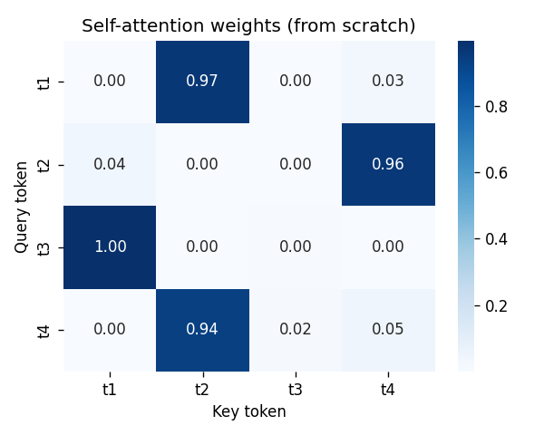
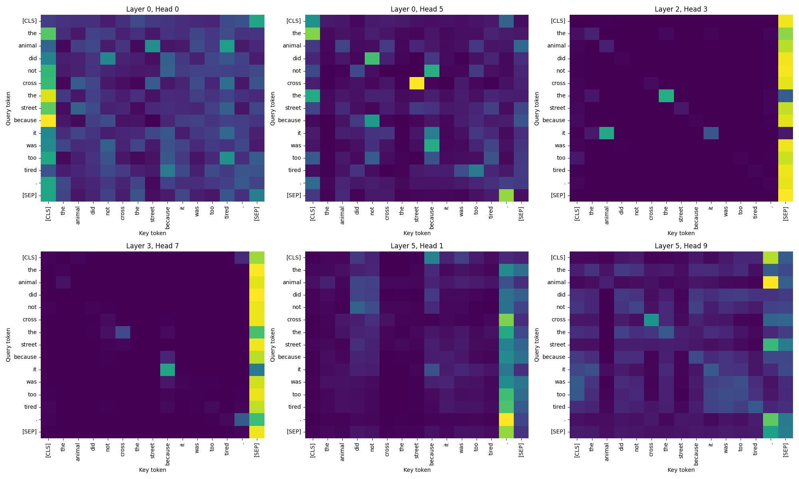
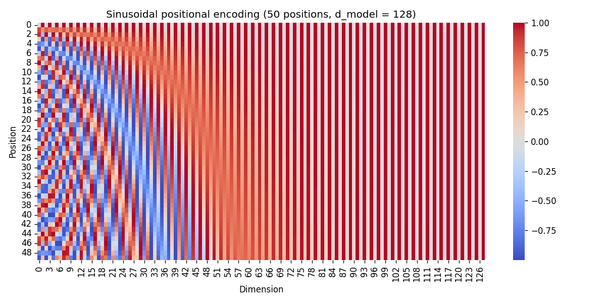
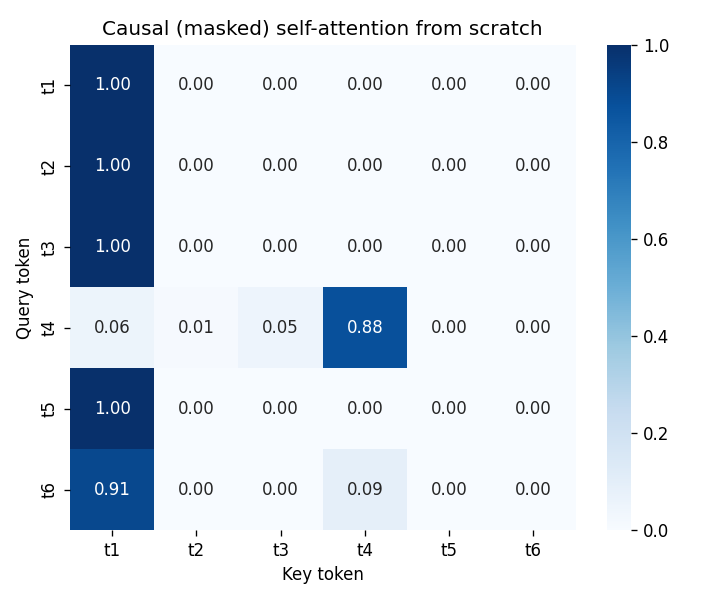
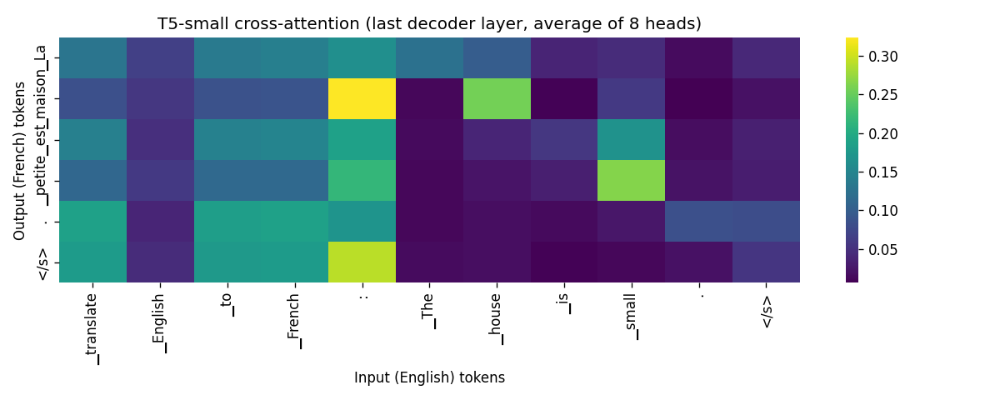
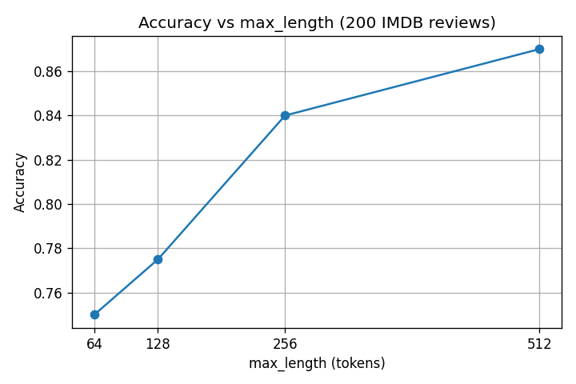
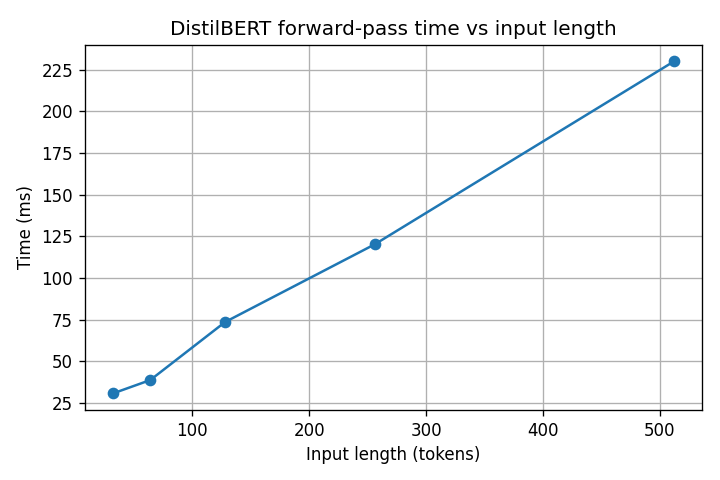

# DL PR 6 - Opening the Transformer

Practical Report 6 for **Deep Learning** (Red & White Skill Education).
No model is trained here. I use small pretrained Hugging Face models and open them up to see how attention, the encoder, the decoder and inference work.

## Models used

| Hugging Face Model ID | Architecture | Used for |
| --- | --- | --- |
| `distilbert-base-uncased-finetuned-sst-2-english` | Encoder-only | Sentiment, attention inspection, positional / LayerNorm study, evaluation |
| `distilbert-base-uncased` | Encoder-only | Fill-mask (Task 4.4) |
| `gpt2` | Decoder-only | Causal attention, greedy loop, decoding strategies, KV-cache, hallucination check |
| `t5-small` | Encoder-decoder | Cross-attention, translation, summarisation, text toolkit |

Data: 200 reviews from the public IMDB test set (`load_dataset('imdb', split='test').shuffle(seed=42).select(range(200))`) and 3 text passages.

## How to run

```bash
pip install -r requirements.txt
jupyter notebook DL_PR6.ipynb      # Kernel > Restart & Run All
jupyter nbconvert --to html DL_PR6.ipynb
```
Everything runs on a normal CPU. Internet is needed only for the first model download.

## Concepts (in my own words)

**Self-attention.** Each token becomes a Query, a Key and a Value. The Query is compared with every Key (dot product), divided by sqrt(d_k), and passed through softmax to get weights. The output is the weighted average of the Values. I built this in NumPy and matched layer 0, head 0 of DistilBERT with `np.allclose`.

**Multi-head attention.** One pattern is not enough, so d_model is split into several heads (768 = 12 x 64). Each head learns its own projections and pattern, and the heads are concatenated and mixed.

**Positional encoding.** Self-attention is order-blind (shuffling the input just shuffles the output). Positional encoding is added to the embeddings so that the same word at different positions looks different. The original Transformer uses sines and cosines; BERT-style models learn the position vectors (max 512).

**Layer normalization.** Each token vector is normalised over its own features (mean 0, std 1), then scaled by gamma and shifted by beta. Unlike BatchNorm it does not depend on batch size or padding, which suits sequences.

**Masked (causal) attention.** Adding -inf above the diagonal before softmax stops a token from seeing the future. Decoders like GPT-2 need this; encoders like DistilBERT do not use it. I confirmed that GPT-2's attention above the diagonal is almost zero.

**Cross-attention.** In an encoder-decoder model (T5) the Queries come from the decoder and the Keys and Values come from the encoder, so the decoder can look at the source sentence while writing the translation.

**Inference.** A decoder generates one token at a time and feeds it back. My manual greedy loop gave the same text as `generate()`. Sampling settings (temperature, top-k, top-p) control randomness, and the KV-cache avoids recomputing keys and values of earlier tokens.

## Plots

| Plot | Caption |
| --- | --- |
|  | Self-attention weights computed from scratch (4 tokens) |
|  | Six real DistilBERT attention heads |
|  | Sinusoidal positional encoding |
|  | Causal mask built from scratch (lower-triangular) |
|  | T5-small cross-attention (French output vs English input) |
|  | Accuracy vs max_length on 200 IMDB reviews |
|  | DistilBERT forward-pass time vs input length |

## Evaluation results (200 IMDB reviews, max_length = 512)

> Fill in after running the notebook.

| Accuracy | Precision | Recall | F1 |
| --- | --- | --- | --- |
| ___ | ___ | ___ | ___ |

Truncation study: accuracy at 64 / 128 / 256 / 512 tokens = ___ / ___ / ___ / ___. Reviews longer than 512 tokens: ___ of 200.

## Two disadvantages I measured

1. **Cost grows with sequence length:** forward pass took ___ ms at 32 tokens and ___ ms at 512 tokens.
2. **Hallucination / limited context:** GPT-2 got ___ of 3 factual prompts right, and ___ reviews exceeded the 512-token limit.

## Video

> Paste your link here: `DL_PR6_YourName_GRID.mp4` (Google Drive "Anyone with link" or YouTube Unlisted)

## Files

- `DL_PR6.ipynb` - the notebook
- `DL_PR6.html` - exported notebook
- `plots/` - saved figures
- `requirements.txt` - library versions used
