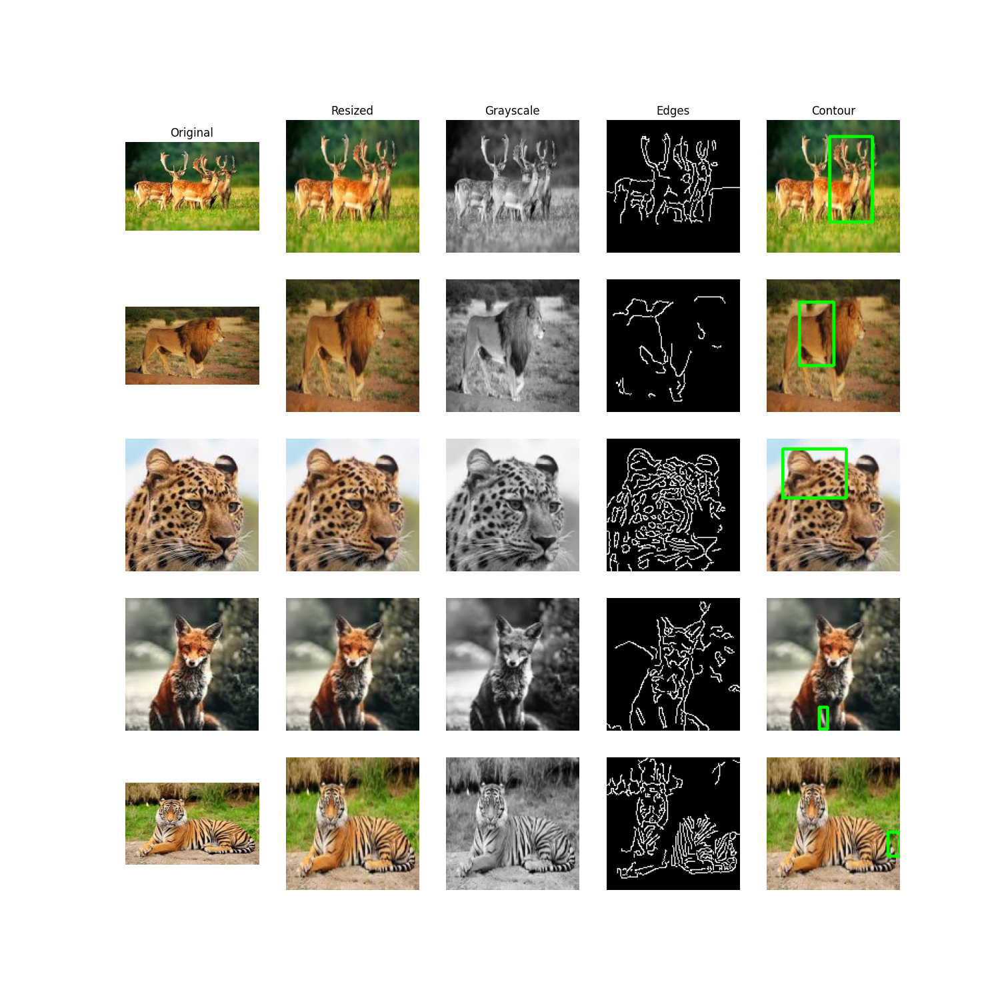

<div align="center">

# 🧠 Deep Learning Practical Exam: Set A

### Five mini-projects. Five core Deep Learning topics. One notebook.


**Built by Maitrak** · B.Tech AI & ML · Red & White Skill Education

[🎥 Video](#-video-walkthrough) · [📊 Results](#-results-at-a-glance) · [🚀 Quick Start](#-quick-start) · [❓ FAQ](#-troubleshooting-and-faq)

</div>

---

## 📑 Table of Contents

1. [Overview](#-overview)
2. [Highlights](#-highlights)
3. [Results at a Glance](#-results-at-a-glance)
4. [Project Structure](#️-project-structure)
5. [Explore Each Step](#-explore-each-step)
6. [Quick Start](#-quick-start)
7. [Tech Stack](#️-tech-stack)
8. [Design Decisions](#-design-decisions)
9. [Challenges and Lessons Learned](#-challenges-and-lessons-learned)
10. [Skills Demonstrated](#-skills-demonstrated)
11. [Troubleshooting and FAQ](#-troubleshooting-and-faq)
12. [What I'd Build Next](#-what-id-build-next)
13. [Video Walkthrough](#-video-walkthrough)
14. [Submission Checklist](#-submission-checklist)
15. [Acknowledgements](#-acknowledgements)

---

## 📌 Overview

This repository is my submission for the **Deep Learning Practical Exam (Set A)**. The brief: act as a Junior Deep Learning Engineer and, within 6 hours, build **five standalone mini-projects**, one per core Deep Learning topic. Each one loads data, builds a model, trains it, evaluates it and saves the result.

The exam is basic-level. It does not ask for state-of-the-art accuracy. It asks for clean, working code and an understanding of **why** each design choice was made. This README documents both the results and the reasoning.

| Step | Topic | What I built |
|:---:|---|---|
| 1️⃣ | **ANN** | Predicts diabetes from 8 medical measurements |
| 2️⃣ | **OpenCV** | Preprocessing pipeline on 5 wildlife photos |
| 3️⃣ | **CNN** | Handwritten digit classifier |
| 4️⃣ | **RNN** | Forecasts monthly airline passengers |
| 5️⃣ | **Transformer** | Sentiment analysis with a pre-trained DistilBERT |
| 6️⃣ | **Comparison** | Results table, written reflection, GitHub submission |

---

## ✨ Highlights

- 🧪 **Five models, one notebook:** ANN, CNN, RNN, a classic OpenCV pipeline and a Hugging Face Transformer, all executed top to bottom.
- 🚫 **No data leakage:** scalers are fitted on training data only, and the time-series split keeps chronological order.
- 🎯 **97.5% accuracy** on the CNN and **20/20** on the clear Transformer test sentences.
- 🖼️ **25 saved OpenCV outputs** (5 images × 5 stages) plus a 5×5 comparison grid.
- 💾 **Three saved models** (`.h5`) that can be reloaded without retraining.
- 📝 **Reflection in every step:** a Markdown cell explains what each layer does and why.

---

## 📊 Results at a Glance

| Step | Task | Dataset | Metric | Result | Train time |
|:---:|---|---|---|:---:|:---:|
| 1️⃣ ANN | Binary classification | Pima Indians Diabetes (768 rows) | Test accuracy | **69.5%** | ~0.1 min |
| 2️⃣ OpenCV | Preprocessing | 5 custom images | n/a | 5 images × 5 operations | n/a |
| 3️⃣ CNN | 10-class classification | MNIST subset (20k train / 4k test) | Test accuracy | **97.5%** | ~0.3 min |
| 4️⃣ RNN | Time-series regression | Airline Passengers (144 months) | Test RMSE | **43.99** passengers | < 0.1 min |
| 5️⃣ Transformer | Sentiment inference | 25 custom sentences | Accuracy on 20 clear sentences | **20 / 20** | no training |

> 💡 **Reading the ANN result:** validation accuracy reached about 80% during training. Test accuracy is lower (69.5%, precision 0.57, recall 0.54) because the test split is small (154 patients) and the dataset is noisy.

### Model sizes

| Model | Parameters | Saved file |
|---|:---:|---|
| ANN | 289 | `ann_diabetes_model.h5` |
| CNN | 121,930 | `cnn_mnist_model.h5` |
| RNN | 2,651 | `rnn_airline_model.h5` |
| Transformer | pre-trained, not saved | loaded from Hugging Face |

---

## 🗂️ Project Structure

```
deep-learning-practical-exam-set-a/
├── DeepLearning_Practical_Exam_SetA.ipynb   # main notebook (fully executed)
├── diabetes.csv                             # Pima Indians dataset
├── images/                                  # 5 input images
│   ├── deer.jpg  Lion.jpg  leopard.jpg  fox.jpg  tiger.jpg
├── outputs/                                 # OpenCV results + 5x5 grid
│   ├── grid_5x5.png
│   └── <name>_resized / _gray / _edges / _contour .jpg  (x5 images)
├── ann_diabetes_model.h5                    # saved ANN
├── cnn_mnist_model.h5                       # saved CNN
├── rnn_airline_model.h5                     # saved RNN
├── requirements.txt
├── summary_report.md
└── README.md
```

---

## 🔍 Explore Each Step

Click a step to expand it.

<details>
<summary><b>1️⃣ ANN: Diabetes Prediction</b></summary>

<br>

**Goal:** predict whether a patient has diabetes (binary classification).

**Dataset:** [Pima Indians Diabetes](https://www.kaggle.com/datasets/uciml/pima-indians-diabetes-database): 768 patients, 8 medical features, target `Outcome` (0 = no diabetes, 1 = diabetes).

| Feature | Meaning |
|---|---|
| Pregnancies | Number of pregnancies |
| Glucose | Plasma glucose concentration |
| BloodPressure | Diastolic blood pressure |
| SkinThickness | Triceps skin fold thickness |
| Insulin | 2-hour serum insulin |
| BMI | Body mass index |
| DiabetesPedigreeFunction | Family-history risk score |
| Age | Age in years |

**Pipeline**
1. Load the CSV and check shape, head and missing values (none were reported as null).
2. Treat zeros in Glucose, BloodPressure, SkinThickness, Insulin and BMI as missing, since they are physiologically impossible, and replace them with the column median.
3. 80/20 stratified train-test split (`random_state=42`) so both splits keep the same diabetic ratio.
4. Scale features with `StandardScaler`, fitted on the training set only.

**Architecture**

```
Input (8) → Dense(16, ReLU) → Dense(8, ReLU) → Dense(1, Sigmoid)
```

| Setting | Value |
|---|---|
| Optimizer | `adam` |
| Loss | `binary_crossentropy` |
| Epochs / batch size | 50 / 32 |
| Validation split | 0.2 |
| Parameters | 289 |

**Test metrics**

| Accuracy | Precision | Recall | F1-Score |
|:---:|:---:|:---:|:---:|
| 0.695 | 0.569 | 0.537 | 0.552 |

**Confusion matrix** (154 test patients)

|  | Predicted No | Predicted Yes |
|---|:---:|:---:|
| **Actual No** | 78 | 22 |
| **Actual Yes** | 25 | 29 |

**Interpretation:** the model finds about half of the diabetic patients (recall 0.54). For a medical screening task that is the number to improve first, since a missed diabetic patient costs more than a false alarm.

</details>

<details>
<summary><b>2️⃣ OpenCV: Image Preprocessing Pipeline</b></summary>

<br>

**Goal:** show a complete image preprocessing pipeline. No model training is involved.

**Images used**

| Image | Original shape (H × W × C) |
|---|:---:|
| deer.jpg | 148 × 223 × 3 |
| Lion.jpg | 148 × 254 × 3 |
| leopard.jpg | 148 × 148 × 3 |
| fox.jpg | 148 × 148 × 3 |
| tiger.jpg | 148 × 242 × 3 |

**Operations applied to every image**

| Stage | Function | Why it is useful |
|---|---|---|
| Original | `cv2.imread` + `cv2.cvtColor(BGR→RGB)` | OpenCV loads BGR, Matplotlib expects RGB |
| Resize | `cv2.resize` (128×128) | A CNN needs one fixed input size |
| Grayscale | `cv2.cvtColor(BGR→GRAY)` | 3 channels → 1, less data, colour ignored |
| Edges | `cv2.GaussianBlur` (5×5) + `cv2.Canny` (100, 200) | Blur removes noise, Canny finds boundaries |
| Contour | `cv2.findContours` + `cv2.boundingRect` | Green box around the largest contour |



All processed images are saved in [`outputs/`](outputs/).

> ⚠️ **Limitation:** plain Canny edges can box background grass or fur texture instead of the whole animal. Segmentation or a trained detector would fix that.

</details>

<details>
<summary><b>3️⃣ CNN: Digit Classification</b></summary>

<br>

**Goal:** classify images into one of 10 classes.

**Dataset:** MNIST (built into Keras): 20,000 training and 4,000 test images, 28×28 grayscale, digits 0 to 9.

> 📝 **Dataset note:** the exam suggests CIFAR-10, but its download was blocked on my network and kept hanging. I switched to MNIST, which has the same structure (10 classes, Keras built-in), so the same architecture applies.

**Pipeline**
1. Slice to 20,000 training and 4,000 test samples.
2. Normalise pixels to [0, 1] by dividing by 255.
3. Reshape to `(28, 28, 1)`.
4. One-hot encode labels with `to_categorical`.

**Architecture**

```
Conv2D(32, 3×3, ReLU) → MaxPool(2×2)
→ Conv2D(64, 3×3, ReLU) → MaxPool(2×2)
→ Flatten → Dense(64, ReLU) → Dense(10, Softmax)
```

| Setting | Value |
|---|---|
| Optimizer | `adam` |
| Loss | `categorical_crossentropy` |
| Epochs / batch size | 10 / 64 |
| Validation split | 0.1 |
| Parameters | 121,930 |

**Training behaviour:** by epoch 10, training accuracy was about 99.7% and validation accuracy about 98.8%. The two curves stay close, so overfitting is small.

**Result:** **97.5% test accuracy.**

| Digit | Precision | Recall | F1 | Support |
|:---:|:---:|:---:|:---:|:---:|
| 0 | 0.96 | 1.00 | 0.98 | 370 |
| 1 | 0.99 | 0.99 | 0.99 | 450 |
| 2 | 0.95 | 1.00 | 0.97 | 418 |
| 3 | 0.97 | 0.99 | 0.98 | 408 |
| 4 | 0.97 | 0.99 | 0.98 | 418 |
| 5 | 0.98 | 0.97 | 0.97 | 372 |
| 6 | 0.99 | 0.96 | 0.97 | 378 |
| 7 | 0.98 | 0.96 | 0.97 | 411 |
| 8 | 0.98 | 0.96 | 0.97 | 384 |
| 9 | 0.99 | 0.93 | 0.96 | 391 |

Digit 9 has the lowest recall (0.93): it is the one most often mistaken for other digits.

</details>

<details>
<summary><b>4️⃣ RNN: Airline Passenger Forecasting</b></summary>

<br>

**Goal:** predict next month's passenger count from the previous 12 months (univariate time-series forecasting).

**Dataset:** [Monthly Airline Passengers](https://raw.githubusercontent.com/jbrownlee/Datasets/master/airline-passengers.csv), 144 months (Jan 1949 to Dec 1960).

**Pipeline**
1. Load the CSV, print `.head(5)` and plot the full series.
2. Scale `Passengers` with `MinMaxScaler` to [0, 1].
3. Build sliding windows with `look_back = 12`: each input is 12 consecutive months, the target is the next month. This gives 132 sequences.
4. Reshape to `(samples, 12, 1)` as Keras RNN layers require.
5. Chronological split: **105 training** and **27 test** sequences, with **no shuffling**.

**Architecture**

```
SimpleRNN(50, tanh) → Dense(1)
```

| Setting | Value |
|---|---|
| Optimizer | `adam` |
| Loss | `mse` |
| Epochs / batch size | 50 / 16 |
| Validation split | none (data is too small) |
| Parameters | 2,651 |

**Result:** test **RMSE = 43.99** passengers. Predictions are inverse-transformed to the original passenger scale before the error is computed.

**Interpretation:** the passenger count grows over the years, so the test months are higher than anything the model saw in training. A simple RNN with a `tanh` activation struggles to extrapolate beyond its training range, and that is the main source of the error.

</details>

<details>
<summary><b>5️⃣ Transformer: Sentiment Analysis</b></summary>

<br>

**Goal:** use a pre-trained Transformer for text classification with **no training**.

**Model:** [`distilbert-base-uncased-finetuned-sst-2-english`](https://huggingface.co/distilbert-base-uncased-finetuned-sst-2-english), loaded through the Hugging Face `pipeline("sentiment-analysis")`.

**Input:** 25 sentences I wrote.

| Group | Count | Example |
|---|:---:|---|
| Clearly positive | 10 | "The film was absolutely brilliant and moving." |
| Clearly negative | 10 | "Worst movie I have ever seen. Completely boring." |
| Ambiguous / neutral | 5 | "The acting was decent but the plot was weak." |

**Findings**
- ✅ **20 / 20** clear sentences classified correctly.
- 🤔 The 5 ambiguous sentences all got very confident predictions, because the model has only POSITIVE and NEGATIVE labels:

| Ambiguous sentence | Predicted | Confidence |
|---|:---:|:---:|
| The acting was decent but the plot was weak. | NEG | 0.9988 |
| It was an okay movie, nothing special. | NEG | 0.9575 |
| Some scenes were great while others were dull. | NEG | 0.9954 |
| The film is fine if you have nothing else to do. | POS | 0.9997 |
| Good visuals but a confusing story. | POS | 0.9990 |

- 🇮🇳 **Indian English test:** *"The movie was timepass only."* → NEGATIVE (0.996) and *"Total bakwaas picture."* → NEGATIVE (0.971). Both are reasonable, but the model was trained on standard English, so this is not guaranteed for other slang.

**Key takeaway:** a high confidence score does not mean a correct or sensible answer.

</details>

<details>
<summary><b>6️⃣ Comparison and Reflection</b></summary>

<br>

| Question | My answer |
|---|---|
| Most challenging step | The RNN: building windows and reshaping the data |
| Best result for the effort | The Transformer: no training needed |
| What I would change in the ANN | Add Dropout and tune the hidden layer sizes |
| Why the CNN beats the ANN on images | Filters keep spatial structure and share weights; an ANN flattens the image and loses it |
| RNN vs Transformer | An RNN reads one step at a time and passes memory forward; a Transformer uses attention to see the whole sequence at once |
| Next step for a production CNN | Train on the full dataset with augmentation, use a deeper or pre-trained model, and serve it through an API |

</details>

---

## 🚀 Quick Start

```bash
# 1. Clone the repo
git clone https://github.com/YOUR_USERNAME/deep-learning-practical-exam-set-a.git
cd deep-learning-practical-exam-set-a

# 2. (Optional) create a virtual environment
python -m venv venv
venv\Scripts\activate          # Windows
# source venv/bin/activate     # macOS / Linux

# 3. Install dependencies
pip install -r requirements.txt

# 4. Launch the notebook
jupyter notebook DeepLearning_Practical_Exam_SetA.ipynb
```

Then choose **Run All**.

**What gets downloaded on the first run**

| Item | Size (approx.) | Used in |
|---|:---:|---|
| MNIST dataset | 11 MB | Step 3 |
| Airline passengers CSV | < 10 KB | Step 4 |
| DistilBERT model | ~260 MB | Step 5 |

**Expected run time:** a few minutes on a normal laptop CPU. No GPU is needed.

**Load a saved model without retraining**

```python
from tensorflow.keras.models import load_model

ann = load_model("ann_diabetes_model.h5")
cnn = load_model("cnn_mnist_model.h5")
rnn = load_model("rnn_airline_model.h5")
```

---

## 🛠️ Tech Stack

| Area | Tools |
|---|---|
| Deep Learning | TensorFlow, Keras |
| Computer Vision | OpenCV |
| NLP | Hugging Face Transformers, PyTorch |
| Data and Metrics | pandas, NumPy, scikit-learn |
| Visualisation | Matplotlib, Seaborn |
| Environment | Python 3.12, Jupyter / VS Code |

---

## 🧭 Design Decisions

| Decision | Reason |
|---|---|
| Median instead of mean for missing values | The medians are robust to outliers in medical data |
| Stratified split on the ANN data | Keeps the diabetic ratio equal in train and test |
| Scaler fitted on training data only | Prevents information from the test set leaking into training |
| `look_back = 12` for the RNN | One full year captures the seasonal pattern |
| No shuffling in the RNN split | Shuffling would put future values into training |
| Softmax + categorical cross-entropy for the CNN | Standard pairing for multi-class classification |
| Pre-trained model for sentiment | Saves time, data and compute; no training required |
| MNIST instead of CIFAR-10 | The CIFAR-10 download was blocked on my network |

---

## 🧩 Challenges and Lessons Learned

- **Blocked CIFAR-10 download:** it hung for over an hour. I cleared the cache, diagnosed the network and switched to MNIST. Lesson: always have a fallback dataset.
- **Kaggle access:** the download needed a login, so I loaded the same Pima data from a public GitHub mirror and saved it as `diabetes.csv`.
- **Data leakage:** the scaler is fitted on the training split only, and the time-series split is never shuffled.
- **Overconfidence:** the Transformer is very sure of itself on ambiguous text. Confidence is not the same as correctness.
- **Small data, noisy results:** the ANN test set has only 154 patients, so its accuracy can move a few points between runs.

---

## 🎓 Skills Demonstrated

| Area | What this project shows |
|---|---|
| Data preprocessing | Handling hidden missing values, scaling, stratified and chronological splits |
| Neural networks | Building and training dense, convolutional and recurrent models in Keras |
| Evaluation | Accuracy, precision, recall, F1, confusion matrix, classification report, RMSE |
| Computer vision | Resizing, colour conversion, blurring, edge and contour detection |
| NLP | Using a pre-trained Transformer and analysing its limits |
| Engineering practice | Reproducible notebook, saved models, `requirements.txt`, documented design choices |

---

## ❓ Troubleshooting and FAQ

<details>
<summary><b>The notebook hangs while loading a dataset</b></summary>

<br>

Usually a blocked or slow download. Interrupt the cell and check your network. Dataset downloads are cached in `~/.keras/datasets`. If a half-downloaded file is stuck there, delete it and retry.

</details>

<details>
<summary><b>I get a Kaggle 403 error</b></summary>

<br>

Kaggle needs a logged-in account. This project avoids it by loading the same data from a public GitHub URL. The code is in the first cells of Step 1.

</details>

<details>
<summary><b>Why is my accuracy slightly different from the table?</b></summary>

<br>

Neural-network weights start from random values, so each run gives slightly different numbers. The ANN has a small test set, so it varies most.

</details>

<details>
<summary><b>I see a "legacy HDF5 format" warning when saving</b></summary>

<br>

It is only a warning. The `.h5` file is saved correctly. Newer Keras recommends the `.keras` format, but the exam asks for `.h5`.

</details>

<details>
<summary><b>I see warnings about <code>input_shape</code> or tf.function retracing</b></summary>

<br>

These are harmless and do not affect results. The first appears because newer Keras prefers an `Input()` layer, and the second because predictions are called on different array shapes.

</details>

<details>
<summary><b>Does it need a GPU?</b></summary>

<br>

No. Every step runs on a CPU in a few minutes.

</details>

---

## 🔮 What I'd Build Next

- **ANN:** add `Dropout(0.3)`, tune layer sizes and use class weights to improve recall.
- **OpenCV:** try segmentation (for example GrabCut) so the box fits the whole animal.
- **CNN:** move to full CIFAR-10 with data augmentation, then deploy behind a small API.
- **RNN:** swap `SimpleRNN` for `LSTM` and detrend the series before training.
- **Transformer:** fine-tune on Indian-English reviews and add a neutral class.

---

## 🎥 Video Walkthrough

📹 **Watch here:** [PASTE_YOUR_VIDEO_URL_HERE](PASTE_YOUR_VIDEO_URL_HERE)

A 5 to 10 minute screen recording with my face on camera, covering each model, its training curves and my interpretation of the results.

---


---

<div align="center">

**Made with ☕ and a lot of `model.fit()` by Maitrak**

*Practical Exam: Deep Learning · Red & White Skill Education*

⭐ If you found this useful, consider starring the repo!

</div>